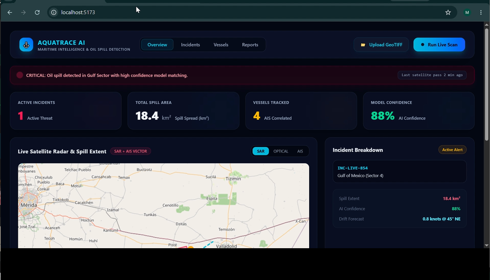
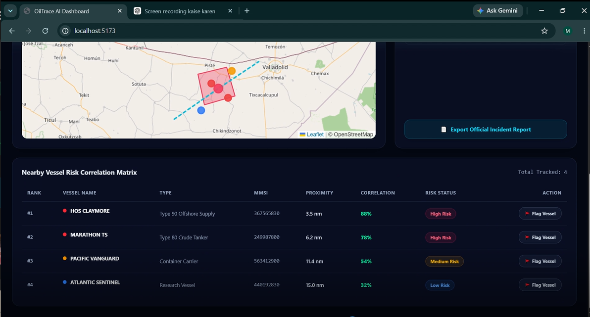

# Oil Trace – Oil Spill Detection & Vessel Identification

## Project Overview

Oil Trace is a Smart India Hackathon (SIH) project focused on detecting oil spills at sea using satellite imagery and correlating detected spill locations with Automatic Identification System (AIS) vessel data to identify potentially responsible vessels.

The project aims to support marine pollution monitoring through satellite-based detection, geospatial analysis, and vessel movement analysis.

## Problem Statement

Leveraging satellite imagery to detect oil spills at sea and correlating the detected spill locations with AIS data to identify potentially responsible vessels.

## Objectives

- Detect potential oil spills using satellite imagery.
- Analyze the geographical location and extent of detected spills.
- Correlate spill locations with AIS vessel tracking data.
- Analyze vessel movement patterns around spill locations.
- Identify and rank potentially associated vessels based on available evidence.

## Technologies Used

- **Python** – Backend development and data processing.
- **Node.js** – JavaScript runtime environment.
- **JavaScript** – Frontend development.
- **Deep Learning** – Oil spill detection.
- **U-Net Architecture** – Satellite image segmentation.
- **Sentinel-1 SAR** – Satellite imagery.
- **AIS (Automatic Identification System)** – Vessel tracking data.
- **Pandas & NumPy** – Data processing and analysis.
- **Geospatial Analysis** – Location-based analysis and visualization.

## Project Workflow

1. Collect and preprocess Sentinel-1 SAR satellite imagery.
2. Apply a U-Net-based model for oil spill detection.
3. Extract spill boundaries and geographical coordinates.
4. Analyze AIS vessel tracking information.
5. Correlate vessel positions and movement patterns with spill location and time.
6. Present analysis results through an interactive dashboard.

## Key Features

- Satellite-based oil spill detection.
- Geographical visualization of detected spills.
- AIS-based vessel tracking and analysis.
- Correlation of vessel movements with detected spill locations.
- Interactive dashboard for presenting analysis results.

## Expected Outcomes

- Detection of potential oil spills using satellite imagery.
- Geographical visualization of spill locations.
- Analysis of vessel movements near detected spill areas.
- Identification of potentially associated vessels for further investigation.

## Applications

- Marine pollution monitoring.
- Environmental protection.
- Maritime surveillance.
- Oil spill investigation.
- Marine safety and monitoring.

## Dashboard Preview

## Dashboard Preview

### Oil Spill Detection

### Vessel Identification

## Project Type

Smart India Hackathon (SIH) Project

## Project Status

The project is currently under maintenance. The dashboard screenshot represents the previously developed interface. The application is not currently running.

## Author

**Malka Saeed**

B.Tech CSE | Aspiring Data Analyst
